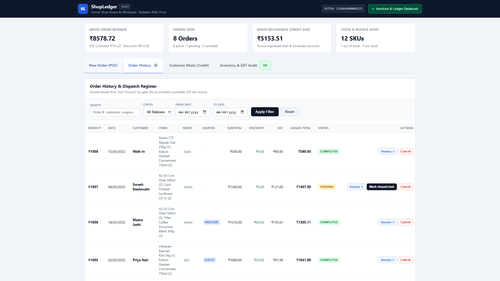

# ShopLedger

**A lightweight point of sale and back-office ledger for a neighborhood shop.**

ShopLedger brings checkout, stock, GST invoices, customer credit, and daily reconciliation into one small Express application. This fork keeps the legacy workshop app focused and documents the fixes made to its billing and inventory flows.


## Product preview

### Point of sale


### Orders and invoices




## What it does

- **Sell:** browse and filter products, build a bill, apply coupons, and record cash, UPI, or khata payments.
- **Fulfill:** track pending dispatches, complete orders, or cancel orders and restore stock.
- **Reconcile:** compare saved order totals with printed invoices and review GST variances.
- **Manage credit:** track customer limits, balances, and cash, UPI, or NEFT settlements.
- **Protect records:** validate checkout requests, support safe retries, and serialize writes to the JSON store.

## Run locally

Requires Node.js and npm.

```sh
npm install
npm start
```

Open [http://localhost:3000](http://localhost:3000). To use another port, set `PORT` before starting the app. Run the built-in regression suite with:

```sh
npm test
```

There is no separate build step. The UI uses browser-native JavaScript and CSS; the server uses CommonJS, Express, and `body-parser`.

## Project map

| Path | Purpose |
| --- | --- |
| `server.js` | Express setup and route mounting |
| `routes/` | Product, order, customer, and report endpoints |
| `lib/` | Inventory, pricing, tax, coupons, orders, ledger, invoices, reports, dates, and JSON storage |
| `public/` | Point-of-sale and back-office interface |
| `data/db.json` | Seeded local application records |
| `test/` | Node.js built-in regression tests |

See the [architecture diagram](docs/shopledger-architecture.svg), [contributor guide](AGENTS.md), and [issue evidence pack](docs/codex-evidence-pack.md) for more detail.

## Data and deployment notes

This repository is a local workshop application, not a production deployment. Normal app writes modify `data/db.json`; back it up before experiments. Tests use isolated data. Before exposing the app to an untrusted network, replace the hard-coded admin export key in `config.js` and add authentication and access controls.
