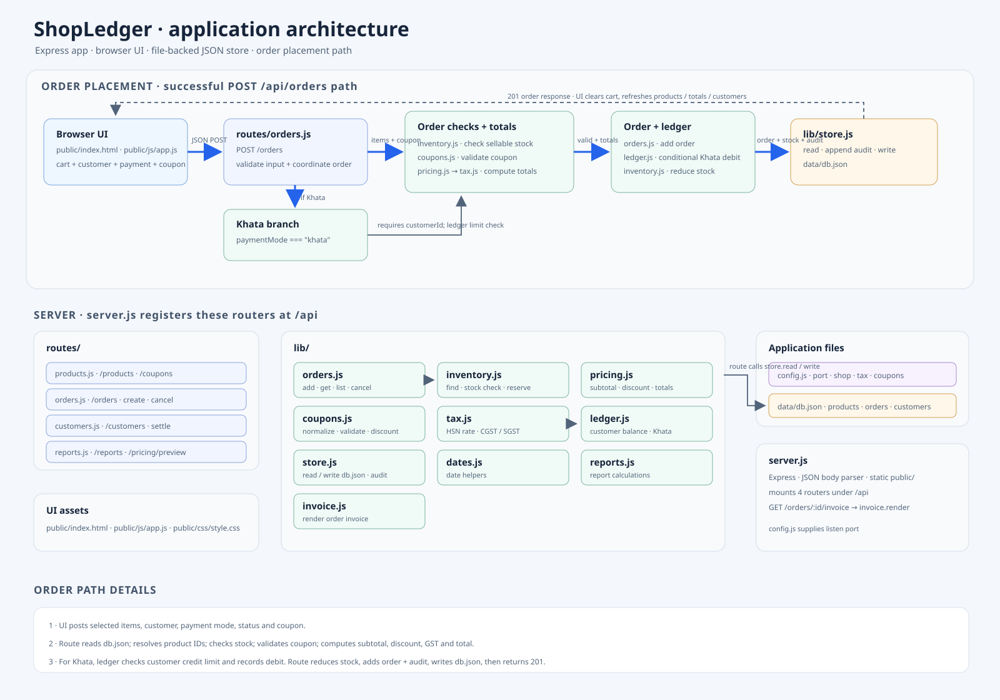

# ShopLedger

ShopLedger is a small shop billing and record-keeping application for a wholesale and retail shop. Staff can manage products and stock, create orders, accept cash or UPI payments, charge customer purchases to Khata (customer credit), record settlements, and review sales and GST reports. GST rates are selected using product HSN codes.

## Live demo

[Open ShopLedger](https://shopledger-legacy-workshop-f70i.onrender.com/)

This is a public demo. It has no login, so use demo data only; changes may be reset when the service restarts or redeploys.

The application uses a local JSON file for its runtime records rather than a database. This is a legacy codebase used for a workshop; the ticket history below describes changes made during that workshop.

## Stack and layout

- **Runtime and server:** Node.js, Express 4, CommonJS (`server.js`).
- **Browser UI:** plain HTML, CSS, and JavaScript in `public/`.
- **Configuration:** `config.js` contains shop, tax, inventory, and coupon settings.
- **Persistence:** `lib/store.js` reads and writes `data/db.json`.
- **HTTP API:** `routes/` contains product, order, customer, and report endpoints.
- **Business logic:** `lib/` contains inventory, pricing, coupons, tax, order, ledger, date, invoice, and report helpers.
- **Tests:** `tests/` contains Node.js built-in `node:test` cases using isolated data.

### Order flow

The browser sends selected items and checkout details to the orders API. The route resolves products from the JSON store, checks stock, calculates subtotal, coupon discount, and HSN-based GST, then records a Khata charge when applicable. It updates inventory, adds the order and audit entry, and writes the updated data to `data/db.json`. The server also serves printable invoices; report endpoints provide summary and reconciliation data.

The diagram follows an order from the browser UI to `routes/orders.js`. The route coordinates pricing, inventory, coupons, tax, and (for Khata purchases) the customer ledger, then saves the order through `lib/store.js` to `data/db.json`. The other routes and library modules show how product, customer, and report features connect to the same server and data store.



## Run and test

```sh
npm start
```

The server listens on port 3000 by default; set `PORT` to use a different port.

```sh
node --test
```

The tests use Node's built-in test runner. The `npm test` script is currently a placeholder that exits with “no test specified.”

## Workshop history

The checkpoints and Codex logs document the investigation and changes made to this legacy application:

1. **Architecture and baseline review:** documented the app, traced the order path, and created the architecture diagram ([checkpoint](checkpoints/cp1.md), [architecture work](logs/2.md)).
2. **Ticket 2 — inventory and cancellation:** fixed cancellation stock restoration, then added a bonus fix to allow selling exactly the remaining sellable stock ([diagnosis and characterization](logs/4.md), [cancellation fix](logs/5.md), [bonus exact-stock fix](logs/8.md)).
3. **Ticket 1 — invoice calculations:** corrected invoice coupon discounts and HSN-based GST calculations to align invoice figures with checkout pricing ([investigation and implementation](logs/6.md)).
4. **Ticket 3 — order history and settlements:** corrected chronological order sorting, date range filtering, and numeric handling of settlement amounts ([investigation and implementation](logs/7.md)).


## Codex Evidence Pack

The logs record the investigation, documentation, diagram, and ticket work below. Each transcript identifies OpenAI Codex v0.172.0. Model and effort entries are session markers copied from the logs; they do not consistently map to individual actions.

| # | Stage and work | Methods / outcome | Model entries in logs | Evidence |
|---|---|---|---|---|
| 1 | **Explore:** reviewed the codebase and traced the order flow | Produced a baseline review with the module map, order path, and identified risks | `gpt-6-luna`: xhigh → low | [checkpoint](checkpoints/cp1.md), [log](logs/1.md) |
| 2 | **Map:** installed Archify and created the architecture diagram | Diagram covers the UI, four routers, ten `lib/` modules, configuration, JSON store, and order flow; SVG and PNG are in Checkpoint 2 | `gpt-6-luna`: medium → xhigh → high → low | [SVG](checkpoints/checkpoint_2/shopledger-architecture.svg), [PNG](checkpoints/checkpoint_2/shopledger-architecture.png), [log](logs/2.md) |
| 3 | **Document:** wrote and refined repository guidance | Updated `AGENTS.md` to describe the current stack, module map, commands, and four change rules | `gpt-6-luna`: medium | [AGENTS.md](AGENTS.md), [log](logs/3.md) |
| 4 | **Ticket 2 — diagnose → characterize → implement → verify/review** | The diagnosis briefly tried both fixes, then reverted the code changes and left in-memory `CURRENT BEHAVIOUR` tests for exact-stock rejection and cancellation failing to restore stock. The later implementation fixed cancellation restoration only; the bonus follow-up then changed the stock boundary so exact sellable stock is allowed. | `gpt-6-luna`: xhigh → high (log 4); xhigh → low (log 5) | [diagnosis](logs/4.md), [implementation and review](logs/5.md), [bonus exact-stock fix](logs/8.md) |
| 5 | **Ticket 1 — diagnose → characterize → implement → verify/review** | Replaced four invoice `CURRENT BEHAVIOUR` tests with correct expectations; fixed coupon discount and HSN-based GST calculations in `lib/invoice.js`. Review found no findings. | `gpt-6-luna`: xhigh | [log](logs/6.md) |
| 6 | **Ticket 3 — diagnose → characterize → implement → verify/review** | Replaced three old-behavior tests with correct expectations; fixed chronological sorting, date filtering, and numeric settlement totals. Review found no spec gaps or documented standards violations; a follow-up confirmed the noted duplicate normalization affects malformed dates only and required no change. | `gpt-6-luna`: xhigh; later high for the review follow-up | [log](logs/7.md) |
