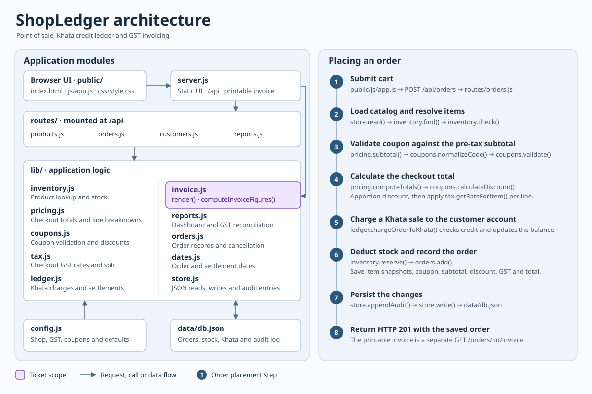

# ShopLedger workshop submission

ShopLedger runs a wholesale and retail counter with GST billing, physical stock, wholesale reservations, and customer credit accounts. This submission addresses all three workshop tickets.

## Run locally

Use Node.js 22 or newer. Run `npm install`, then `npm start`, and open http://localhost:3000. Placing orders and recording payments in this instance update the tracked shop database.

## Review the fixes

| Ticket | What to inspect | Expected result |
| --- | --- | --- |
| Invoice reconciliation | Open Inventory & GST Audit, then view the invoice for order #1002 in Order History. | All eight seeded orders reconcile. Invoice #1002 totals ₹963.90, including ₹45.90 GST. The invoice uses checkout’s line-level pricing calculation. |
| Stock and cancellation | Run the last-unit, oversell, and cancellation tests. | A product with four physical units and three reserved can sell one unit. Cancelling restores physical stock once. |
| History and Khata | Run the date-range and settlement tests. | History sorts across year boundaries and includes both date endpoints. A ₹500 payment against ₹1,232.01 leaves ₹732.01. |

The interface groups revenue with order history, credit balances with customer accounts, and stock counts with inventory. A mobile shortcut connects the product register to the current bill. Checkout also rejects non-positive and fractional quantities.

## Verify

Run `npm test` for the unit and HTTP integration suite. The tests use in-memory inputs or a temporary app copy with a synthetic database. The HTTP suite exercises checkout, cancellation, settlement, invoices, reporting, and rejection paths.

The optional browser workflow uses Microsoft Edge and Playwright Core. With Edge installed, run these commands from the repository in PowerShell:

```powershell
$qaTools = Join-Path ([System.IO.Path]::GetTempPath()) 'shopledger-browser-tools'
npm install --prefix $qaTools playwright-core@1.65.1
$env:NODE_PATH = Join-Path $qaTools 'node_modules'
node qa/browser.cjs
```

The browser suite completes a discounted credit sale, checks its invoice, cancels it, and records a settlement in a disposable shop at 1440px and 390px widths.


