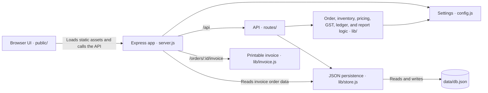

# ShopLedger architecture

The order API checks sellable stock before deducting order quantities from physical stock. Cancellation restores those quantities and preserves wholesale reservations. The order routes persist successful changes through the JSON store.
