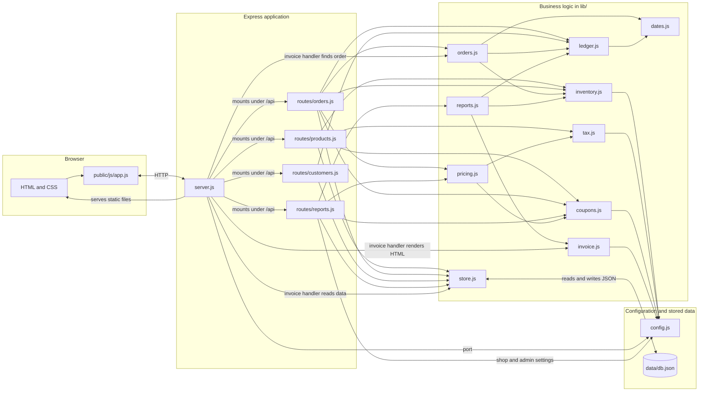
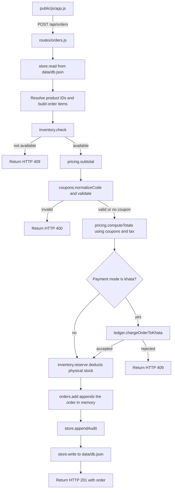

# ShopLedger Architecture

The browser loads the static interface from `public/` and sends requests to the Express application. Route handlers call the business logic in `lib/`. The JSON file is accessed through `lib/store.js`.

## Component map

## Order placement flow

This shows the `POST /api/orders` path. The Khata charge is only used when the payment mode is `khata`.

## Reading the diagrams

- Express serves the browser files, parses JSON request bodies, and mounts the four route modules under `/api`.
- The order route checks the requested products and available stock before pricing. Pricing applies coupon rules and resolves GST through `tax.js`.
- If the order uses Khata, the route charges the customer account before deducting stock. It then adds the order and audit entry and saves the updated JSON file.
- `store.js` reads and writes `data/db.json`, which contains the shop's products, orders, customers, settlements, audit log, and ID counters.
- The printable invoice endpoint is registered directly in `server.js`; it reads the data, finds the order, and renders invoice HTML.

## Source files inspected

- `server.js`, `config.js`, `package.json`
- `public/index.html`, `public/js/app.js`, `public/css/style.css`
- `routes/products.js`, `routes/orders.js`, `routes/customers.js`, `routes/reports.js`
- `lib/store.js`, `lib/orders.js`, `lib/inventory.js`, `lib/pricing.js`, `lib/tax.js`, `lib/coupons.js`, `lib/ledger.js`, `lib/reports.js`, `lib/invoice.js`, `lib/dates.js`
- `data/db.json`
