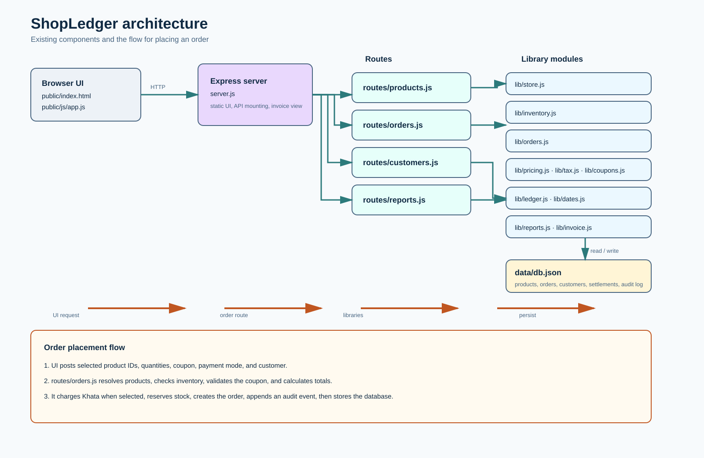

# ShopLedger 0.8.4 architecture

**Checkpoint 2 · GeeksforGeeks × OpenAI · Build with Codex**

[Open the standalone HTML diagram](shopledger-architecture.html)

## Request handling

The browser runs the POS, order register, Khata desk, dashboard, and audit views using static files from [public/](../public/). [server.js](../server.js) creates the Express app, applies JSON body parsing, serves the static files, and mounts the product, order, customer, and reporting routers under `/api`. It handles `GET /orders/:id/invoice` directly by reading the store, looking up the order, and calling `invoice.render`.

## Order placement

1. The browser submits `POST /api/orders`. The handler reads the store, resolves catalog products, and validates sellable stock with `inventory.check`. [Order router](../routes/orders.js)
2. The handler validates the coupon and calculates the order total. `pricing.computeTotals` uses the coupon rules and HSN-based tax calculation. [Pricing](../lib/pricing.js) · [Tax](../lib/tax.js) · [Coupons](../lib/coupons.js)
3. For Khata orders, the handler calls `ledger.chargeOrderToKhata` to check credit and update the running balance. It then deducts physical stock through `inventory.reserve`, records the order through `orders.add`, and appends an audit entry. [Ledger](../lib/ledger.js) · [Inventory](../lib/inventory.js) · [Orders](../lib/orders.js)
4. The handler writes the updated database and returns the stored order as JSON with HTTP `201 Created`. [Order router](../routes/orders.js) · [Store](../lib/store.js)

## Configuration, persistence, and reporting

[config.js](../config.js) supplies the server port, shop metadata, GST slab mapping, coupon rules, inventory defaults, and export key. [lib/store.js](../lib/store.js) reads and writes [data/db.json](../data/db.json) synchronously. The file contains products, customers, orders, settlements, audit entries, and counters for new orders and settlements.

The dashboard aggregates stored orders, inventory, and Khata balances. GST reconciliation compares stored order figures with the printable invoice calculation, which recalculates tax and discounts independently. [Reports](../lib/reports.js) · [Invoice](../lib/invoice.js)
