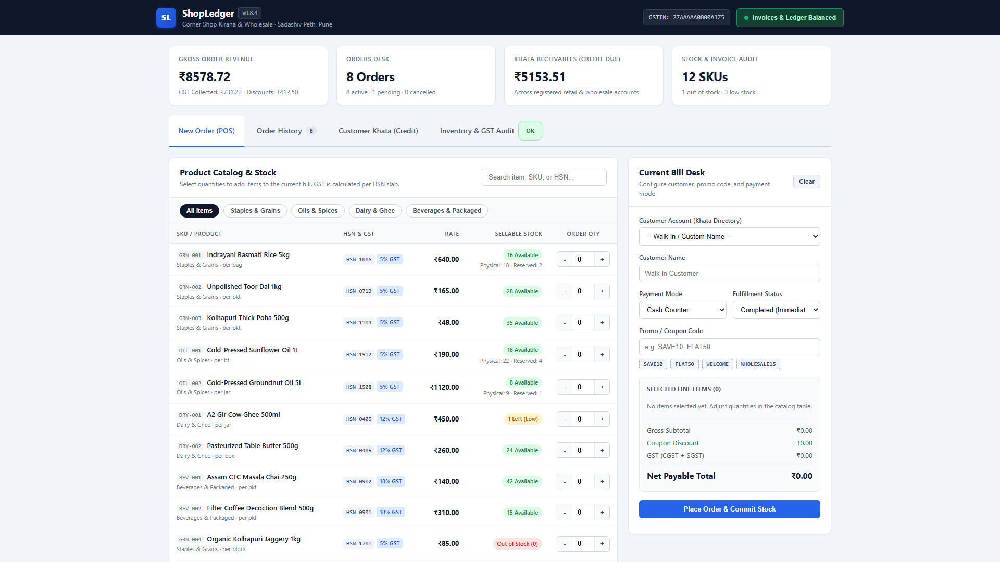
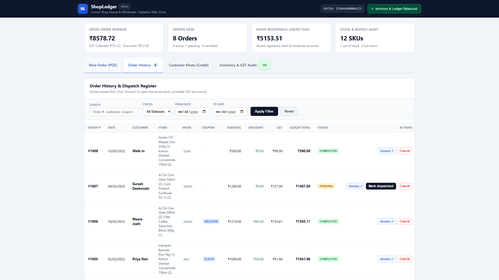
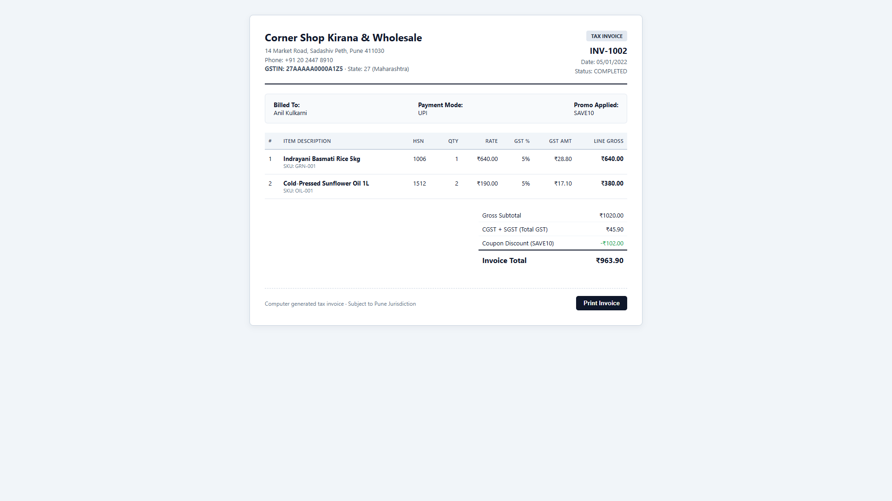

# ShopLedger Codex Evidence Pack

This pack records the issue fixes, test evidence, and visible application state for review. Screenshots use the repository's seeded demonstration records.

## Repository and delivery

- Fork: [SMKehTDOG2335/shopledger-legacy-workshop](https://github.com/SMKehTDOG2335/shopledger-legacy-workshop/tree/fix/shop)
- Working branch: `fix/shop`
- Commit: `03271f3` — `fix ShopLedger billing and inventory issues`
- Upstream pull request: [#574](https://github.com/SampurnR/shopledger-legacy-workshop/pull/574)
- PR status: open and unmerged. GitHub reported it mergeable, but the authenticated account lacks permission to merge into the upstream repository.

## Issue traceability

| Issue | Reported behavior | Fix and test evidence |
| --- | --- | --- |
| [#1](https://github.com/SampurnR/shopledger-legacy-workshop/issues/1) | Printed invoice disagreed with checkout totals and HSN GST. | Invoice uses saved checkout subtotal, discount, tax, total, and line snapshots; legacy orders use their sale-era HSN rates. Covered by `invoice figures use saved checkout totals and legacy HSN rates`, `invoice figures preserve the checkout HSN tax and coupon amounts`, and the legacy-rate characterization test. |
| [#2](https://github.com/SampurnR/shopledger-legacy-workshop/issues/2) | Exact remaining stock could not be sold; cancellation did not restore stock. | Inventory checks permit exact remaining quantity and cancellation restores physical stock. Covered by the stock and cancellation regression tests. |
| [#3](https://github.com/SampurnR/shopledger-legacy-workshop/issues/3) | Order sorting/date filters were wrong; string settlement amounts corrupted balances. | Dates normalize before filtering/sorting; settlements coerce and round amounts to paisa. Covered by date and settlement tests. |
| [#409](https://github.com/SampurnR/shopledger-legacy-workshop/issues/409) | Checkout retries, stale previews, input validation, GST, rounding, pending dispatch, feedback, accessibility, and JSON writes had reliability gaps. | Covered by API integration and unit tests for idempotency, validation, GST preservation, coupon allocation, dispatch completion, and atomic serialized writes. UI changes add preview sequencing, network feedback, and keyboard-accessible coupon buttons. |
| [#435](https://github.com/SampurnR/shopledger-legacy-workshop/issues/435) | Duplicate report of exact-stock sale and cancellation restoration. | Same implementation and tests as #2. |

## Reproduction and test-first evidence

The original base revision was checked in a temporary copy with its own `data/db.json`, on port 3011. Its `/orders/1002/invoice` response showed **₹1,083.24 total and ₹183.60 GST**, while the recorded order shows **₹963.90 total and ₹45.90 GST**. The correct-behavior invoice characterization tests failed against that base copy (2 failed, 0 passed).

The temporary app and copied database were removed after reproduction. The repository's `data/db.json` was not changed. The remaining invoice warning behavior was characterized as well: an order without a saved total should display its derived total without a false reconciliation warning.

Final verification on the working branch:

```text
node --test
17 tests passed
0 failed
```

## Screenshots

### Point of sale and catalog



### Order history and pending dispatch



### Corrected invoice for order 1002



## Architecture and contribution guidance

- [Architecture diagram](shopledger-architecture.svg)
- [Repository contributor guide](../AGENTS.md)
- [GitHub issue workflow](agents/issue-tracker.md)
- [Domain documentation rules](agents/domain.md)

## Skills applied

| Skill/workflow | Evidence in this repository or task |
| --- | --- |
| Find skills | Skill-discovery instructions followed; no project files required. |
| Agent Browser | Installed and used to inspect the running app and capture the screenshots above. |
| GitHub issues | Issue tracker documented in `docs/agents/issue-tracker.md`; issue details mapped to tests above. |
| Systematic debugging | Reproduced the base failure in an isolated copy before changing behavior. |
| Test-driven development | Added/ran characterization and regression tests before the final fix. |
| Verification | Ran the complete `node --test` suite and inspected the final PR state. |
| Matt Pocock setup | Added `AGENTS.md`, issue-tracker guidance, and domain-doc guidance. |
| Ponytail build guidance | Followed for small, module-focused changes; no build script exists in this project. |
| Karpathy perspective | Skill instructions loaded; no perspective-specific repository artifact applies to this app. |
