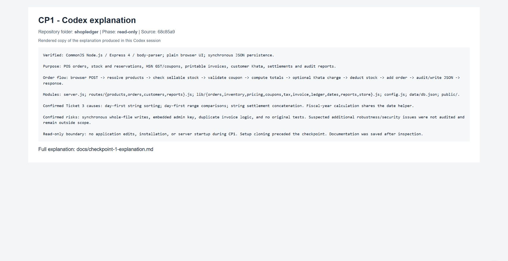
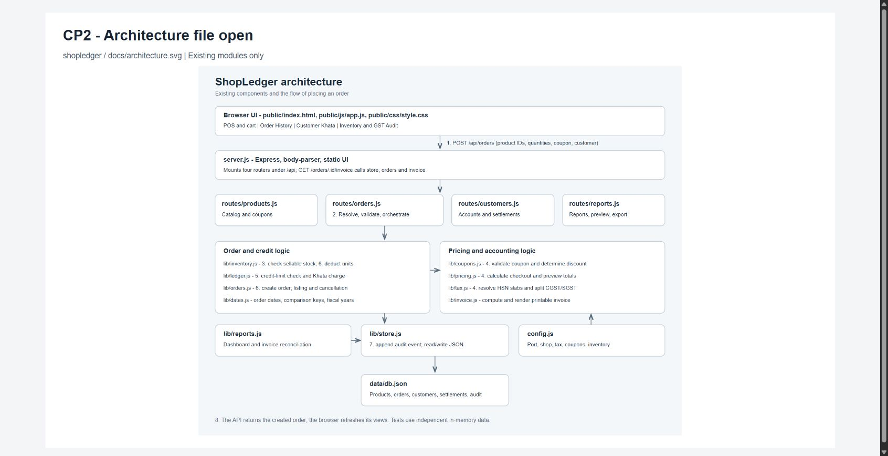
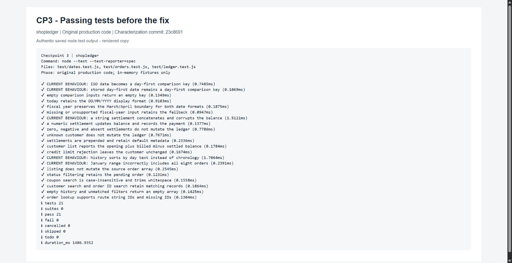
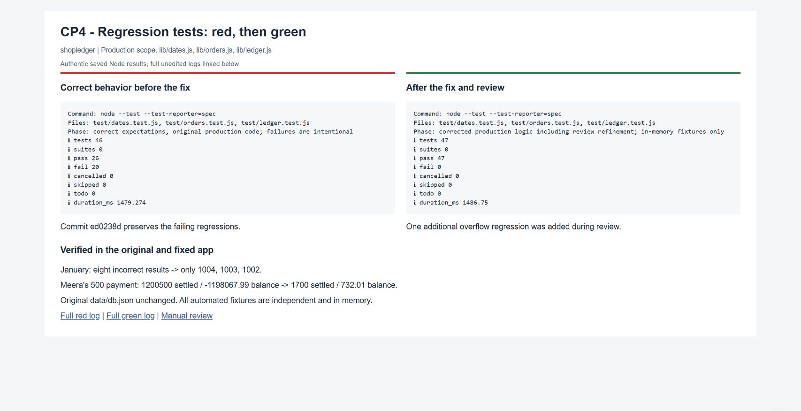
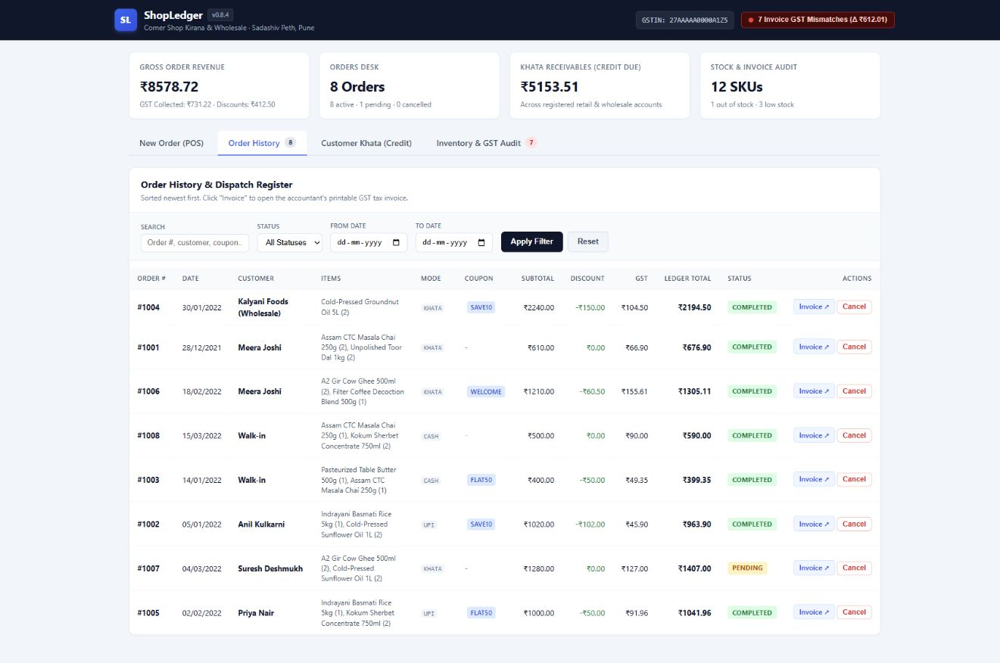
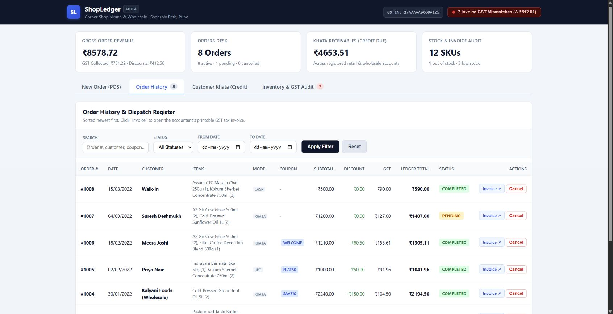
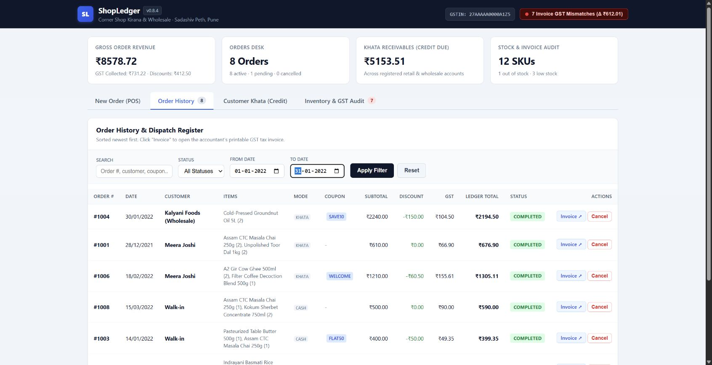
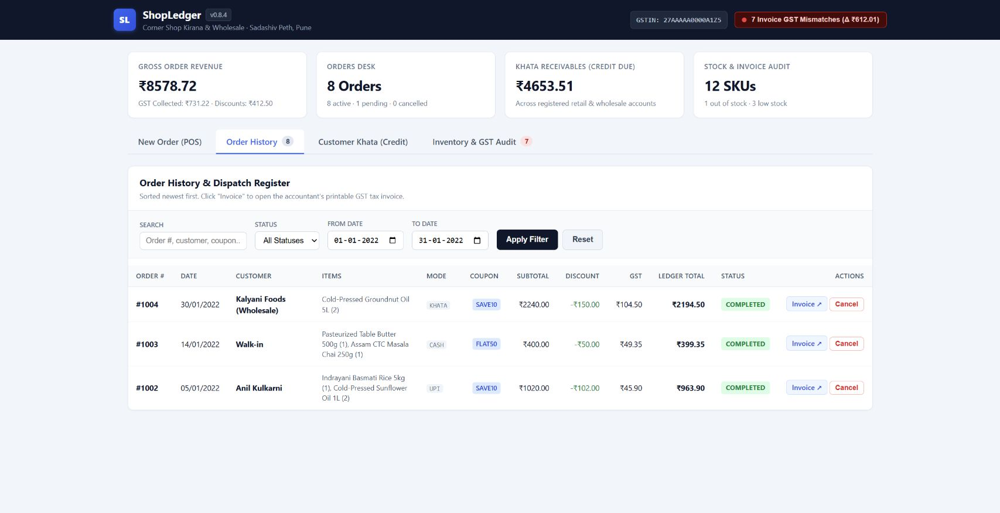
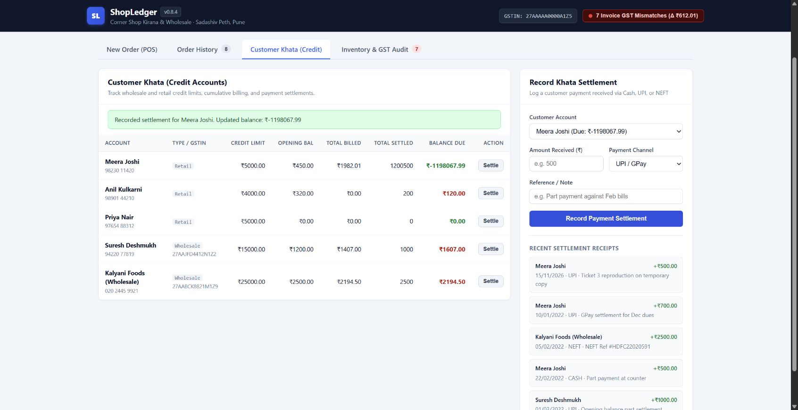
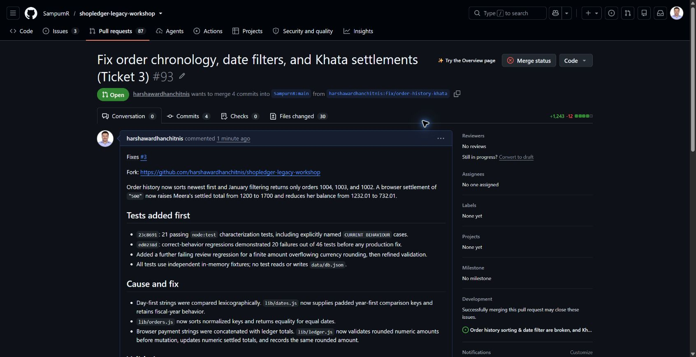

# Ticket 3 evidence

## Checkpoints

### CP1 Explanation

Rendered copy of the Codex explanation produced in this session; folder and read-only phase are visible. This is not a native desktop-chat screenshot.

### CP2 Architecture

### CP3 Characterization tests

Authentic saved Node output, rendered for readability. [Raw output](cp3-characterization.txt).

### CP4 Failing and passing tests

Summaries are extracted from the unedited logs. [Red log](cp4-regression-red.txt), [green log](cp4-regression-green.txt), [review refinement red log](review-overflow-red.txt).

### CP4 Original and fixed app

All app captures use disposable copies. The final checkout's database is unchanged.

Original chronology:

Fixed chronology:

Original January filter (incorrectly includes other months):

Fixed January filter (1004, 1003, 1002 only):

Original settlement (1200500 settled, -1198067.99 balance):

Fixed settlement (1700 settled, 732.01 balance):

API observations: [before](app-before-api.json), [after](app-after-api.json).

### CP5 Pull request

