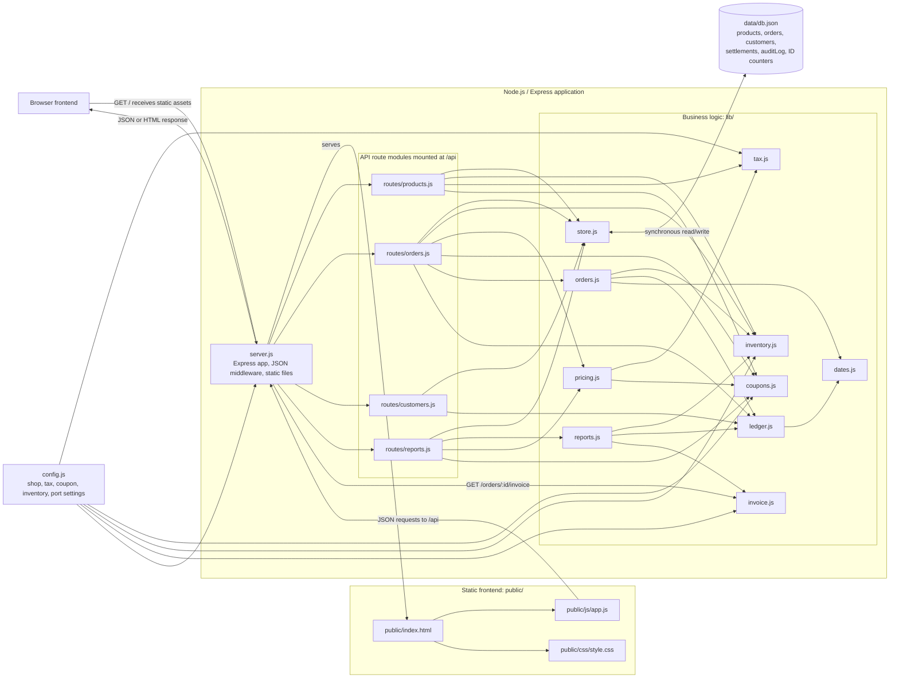
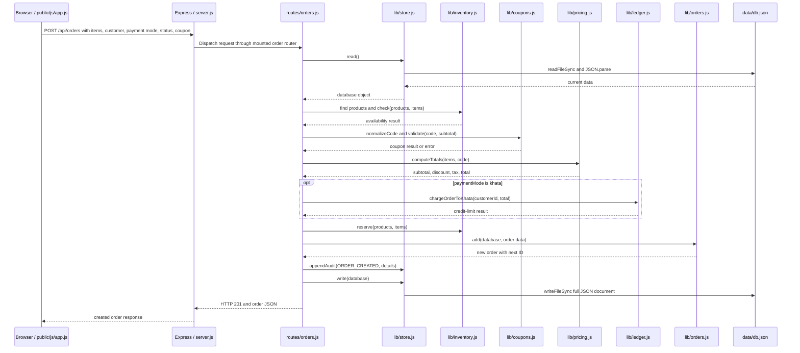

# ShopLedger Architecture

## 1. System Overview

**Verified architecture.** ShopLedger is a single-process Node.js/Express application. It serves a static browser UI from `public/`, exposes JSON endpoints under `/api`, and stores all operational data in one local JSON file: `data/db.json`. Route modules coordinate HTTP requests, `lib/` modules hold the domain calculations and mutations, and `lib/store.js` synchronously reads and writes the datastore.

There are no separate database, queue, authentication service, background worker, or external API integration in this repository.

## 2. Architecture Diagram

**Request/response interpretation:** `public/js/app.js` calls the `/api` endpoints; `server.js` dispatches requests to the mounted route routers; routes use `lib/` and `store.js`; the resulting JSON is returned to the browser. The separate invoice endpoint returns HTML rendered by `lib/invoice.js`.

## 3. Order Placement Flow

**Verified error paths:** an empty order, unknown product, invalid coupon, insufficient stock, missing Khata customer, or exceeded credit limit returns an error before the final write. The sequence above describes the successful path.

## 4. Module Responsibilities

| File or module | Verified responsibility |
|---|---|
| `server.js` | Creates Express, parses JSON, serves `public/`, mounts API routers under `/api`, and serves printable invoice HTML. |
| `routes/products.js` | Lists/filter products and exposes active coupons. |
| `routes/orders.js` | Lists, fetches, creates, and cancels orders; coordinates validation, pricing, inventory, ledger, audit, and persistence. |
| `routes/customers.js` | Lists customer/settlement data and records Khata settlements. |
| `routes/reports.js` | Serves dashboard and GST-reconciliation data, pricing previews, and guarded full-data export. |
| `lib/store.js` | Locates `data/db.json`, ensures its expected top-level collections, synchronously reads/writes it, and appends capped audit entries. |
| `lib/inventory.js` | Finds products, derives sellable stock, checks availability, deducts physical stock for committed orders, restores physical stock for cancelled orders, and summarizes inventory. |
| `lib/pricing.js` | Computes subtotal, coupon discount, discount allocation, GST, and order totals. |
| `lib/tax.js` | Resolves HSN/default GST rates and splits GST into CGST and SGST. |
| `lib/coupons.js` | Normalizes, validates, calculates, and lists configured coupons. |
| `lib/orders.js` | Creates, fetches, lists/filters, and cancels order records. |
| `lib/ledger.js` | Computes customer balances, charges/reverses Khata debits, and records settlements. |
| `lib/reports.js` | Builds dashboard figures and compares stored order figures with invoice figures. |
| `lib/invoice.js` | Computes and renders printable HTML tax invoices. |
| `lib/dates.js` | Formats dates and normalizes date-filter strings. |
| `config.js` | Holds port, shop identity, tax slabs, inventory defaults, coupons, and the export key. |
| `data/db.json` | Persists application state and next-ID counters. |
| `public/index.html`, `public/js/app.js`, `public/css/style.css` | Define the page, browser interactions/API calls, and presentation respectively. |

## 5. Data Flow

1. The browser loads `index.html`, CSS, and JavaScript from Express static-file serving.
2. `public/js/app.js` fetches products, customers, orders, reports, pricing previews, and coupon data as JSON.
3. Each API route calls `store.read()`, which parses the entire `data/db.json` file into an in-memory object.
4. Routes pass that object to the appropriate `lib/` functions. Those functions compute values and, for mutations, update the same in-memory object. Creating an order deducts each line quantity from the matching product's physical `stock`; cancellation restores that quantity using the order-line `id`, without changing `reserved` stock.
5. Successful mutations append an audit event and call `store.write()`, which serializes and overwrites the whole JSON document.
6. The route returns JSON to `app.js`, which renders the result in the page. Invoice requests instead render an HTML response directly.

## 6. Architectural Risks

The following are verified from the current source and are documented only; this checkpoint does not change them.

- **Single-file persistence and concurrent writes:** each change reads and rewrites the entire JSON file synchronously. Concurrent requests or processes can overwrite one another's changes, and an interrupted write can damage the datastore.
- **Resolved in CP4 — cancellation inventory restoration:** cancellation now calls `inventory.release()` with order lines that use `id`; it restores each line quantity to the matching product's physical `stock` and does not modify `reserved`. The existing `orders.cancel()` guard rejects already-cancelled orders before release runs, preventing a second stock restoration.
- **Pricing/invoice divergence:** order pricing calculates tax after coupon-discount allocation; invoice figures calculate line tax on gross amounts and apply coupon logic differently. The application includes reconciliation specifically to detect mismatches.
- **Settlement amount coercion:** `recordSettlement()` adds the supplied request value directly to `totalSettled`; the browser supplies that amount as a string, so JavaScript string concatenation can occur.
- **Weak access control:** write endpoints do not implement authentication. The export endpoint relies on a hard-coded key in `config.js`, supplied as a query parameter.
- **Validation gaps:** order status and payment mode are not constrained to known values; duplicate product lines are checked individually rather than as one combined quantity.
- **Date comparisons:** order filtering compares normalized `DD/MM/YYYY` strings lexically, which does not preserve chronological ordering across all months and years.
- **Output encoding:** the browser script uses `innerHTML` with data returned from the API without consistent escaping, creating an XSS risk if persisted values are untrusted.
- **Legacy maintenance signals:** the declared Express and `body-parser` versions are old, there is no dependency lockfile, and the project has no automated tests.

## Verified Facts vs. Assumptions

All diagrams and module/data-flow descriptions above are verified from the repository source. The only contextual assumption is that ShopLedger is intended for trusted internal staff, inferred from its package description and absence of authentication; the source does not define a formal deployment or security boundary.
